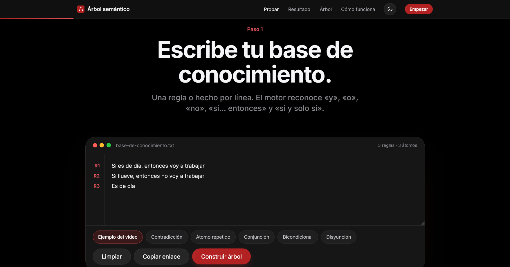
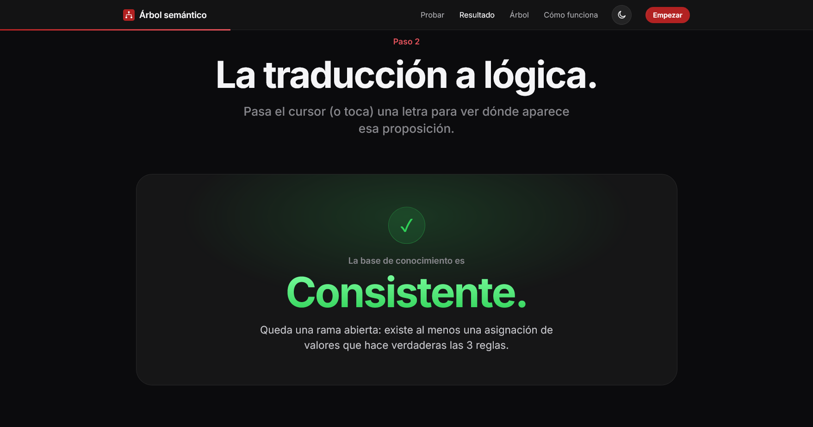
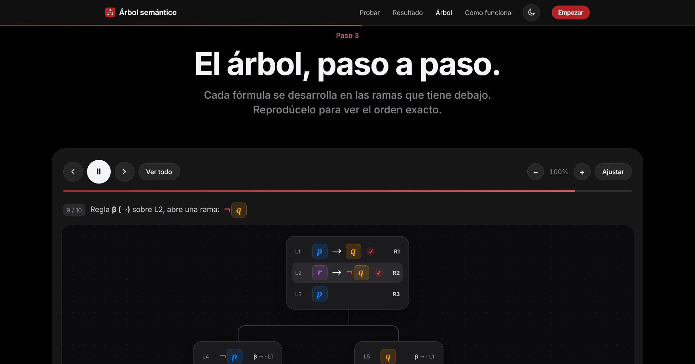

  
  
  
  
  

# Motor de inferencia proposicional

Proyecto para la misión "Del lenguaje natural al árbol semántico" (materia de Inteligencia Artificial).

Convierte reglas escritas en español a lógica proposicional y construye el árbol semántico (método de tableaux) para determinar si una base de conocimiento es consistente.

## Cómo correrlo

No necesita instalación ni servidor: se abre `index.html` directamente en el navegador.

## Capturas

| 1. Escribe la base de conocimiento | 2. Traducción a lógica y resultado | 3. El árbol, paso a paso |
| --- | --- | --- |
|  |  |  |

## Qué ofrece la interfaz

- Análisis en vivo mientras escribes (con `Ctrl` + `Enter` vas directo al resultado) y ejemplos de un clic.
- Cada átomo tiene su propio color en la tabla, en el texto de la regla, en las fórmulas y en el árbol; al pasar el cursor sobre una letra se resaltan todas sus apariciones.
- El árbol se reproduce paso a paso (reproducir, avanzar, retroceder) y explica qué regla α/β se aplicó en cada paso; tiene zoom y se ajusta solo al ancho de la pantalla.
- Cada rama abierta se muestra como asignación de valores y se comprueba que hace verdaderas todas las reglas.
- «Copiar enlace» genera una URL (`?kb=...`) que abre la página con esa misma base de conocimiento.
- Tema claro y oscuro (botón en la barra). Recuerda la elección; si nunca se eligió, sigue al sistema.
- Avisos bajo el editor cuando una regla probablemente no quedó como se quería: un «si» sin consecuencia, dos proposiciones casi iguales con letras distintas, o la misma palabra en otra forma («llueve» / «llueva»).
- Atajos en el árbol: `←` `→` para avanzar o retroceder, `Espacio` para reproducir.
- «Imprimir o guardar en PDF» genera una versión limpia en claro con la tabla, las fórmulas, el árbol completo y los modelos.

## Pruebas

`tests/pruebas.html` verifica el motor punto por punto contra la rúbrica de la misión (120 pruebas):
parser y conectivos, frases naturales («cuando», «solo si», «ni… ni», «condición necesaria», «basta que… para que», listas numeradas…), átomos repetidos, negación, paréntesis, las 9 reglas de expansión, cierre de ramas,
modelos, el caso del video, una prueba masiva de 1000 bases al azar comparadas contra la tabla de verdad,
y una revisión de la página real con el caso del video. Se abre desde el pie de la página
(«Ver las pruebas del motor»). Necesita servirse desde un servidor (o la URL pública), no como archivo suelto,
porque revisa `index.html` dentro de un iframe.

## Estructura

- `index.html` — estructura de la página.
- `css/estilos.css` — estilos visuales.
- `js/motor.js` — lógica pura: parser de lenguaje natural, registro de átomos y algoritmo del árbol semántico. No toca el DOM.
- `js/interfaz.js` — conecta `motor.js` con la pantalla (lee el textarea, pinta tabla, reglas y árbol).
- `docs/especificacion.md` — explicación en teoría de la gramática y el algoritmo usados.
- `docs/capturas/` — capturas de pantalla usadas en este README.
- `examples/casos-prueba.txt` — conjuntos de reglas de ejemplo para probar la herramienta.
- `assets/favicon.svg` — ícono del proyecto.
